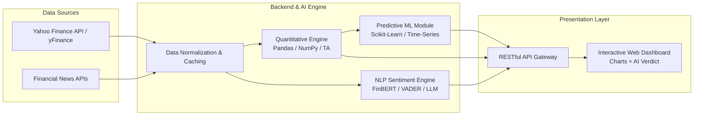

<div align="center">

# 📈 MarketMind AI
### *An AI-Powered Stock Market Analysis & Financial Intelligence Platform*

[](https://python.org)
[](https://reactjs.org)
[](#)
[](#)

<p align="center">
  <b>Bridging the gap between raw, volatile stock market data and actionable investment intelligence.</b>
  <br />
  <a href="#-1-executive-summary">Executive Summary</a> •
  <a href="#-3-system-architecture">Architecture</a> •
  <a href="#-5-core-modules--features">Core Modules</a> •
  <a href="#-7-local-setup--installation">Quick Start</a>
</p>

</div>

---

## 🎯 1. Executive Summary

**MarketMind AI** is a unified financial decision-support system designed to democratize institutional-grade market intelligence for retail investors, analysts, and students. Rather than acting as a black-box trading bot, MarketMind AI synthesizes **quantitative technical indicators** with **qualitative Natural Language Processing (NLP) news sentiment** into a single, intuitive interface.

### Why MarketMind AI?
* **📊 Unified Analytics:** Combines real-time OHLCV (Open, High, Low, Close, Volume) charting with automated sentiment polarity.
* **🧠 Noise Reduction:** Filters thousands of daily financial headlines into clear **Bullish**, **Bearish**, or **Neutral** confidence scores.
* **⚡ Accessible Intelligence:** Eliminates the need to jump between fragmented charting tools, news portals, and quantitative screeners.

---

## ⚠️ 2. Problem Statement vs. Proposed Solution

Retail participants face severe information asymmetry compared to institutional desks. MarketMind AI directly addresses the three primary bottlenecks in manual stock analysis:

| Market Challenge | Traditional Retail Approach | The MarketMind AI Solution |
| :--- | :--- | :--- |
| **Information Overload** | Manually reading dozens of news articles and earnings reports per ticker. | **Automated NLP Sentiment Engine** scrapes and scores financial news polarity in real time. |
| **Emotional & Biased Trading** | Impulsive decisions driven by FOMO, clickbait headlines, and delayed reactions. | **Data-Backed AI Summaries** provide objective, emotion-free synthesis of market catalysts. |
| **Fragmented Tooling** | Switching between TradingView (charts), Yahoo Finance (news), and Excel (models). | **All-in-One Dashboard** integrating technical indicators, news mood, and trend forecasting. |

---

## 🏗️ 3. System Architecture & Data Pipeline

MarketMind AI operates on a four-tier asynchronous pipeline that ingests raw market feeds, processes quantitative and textual signals in parallel, and serves insights to the client dashboard.



<details>
<summary><b>🎙️ Click to expand Pipeline Breakdown (Presentation Notes)</b></summary>
<br>

1. **Ingestion & Caching Layer:** Fetches live ticker metrics and historical OHLCV time-series data while caching frequent queries to prevent API rate-limit exhaustion.
2. **Quantitative Processing:** Computes key momentum and trend indicators including **RSI (Relative Strength Index)**, **MACD**, and **Simple/Exponential Moving Averages (SMA/EMA)**.
3. **NLP Sentiment Analysis:** Parses ticker-specific financial headlines using domain-adapted lexical and transformer models to quantify market psychology.
4. **Client Presentation:** Renders responsive candlestick charts alongside an executive AI summary explaining *why* a stock is moving.

</details>

---

## 🛠️ 4. Technology Stack

| Layer | Technologies Used | Purpose |
| :--- | :--- | :--- |
| **Frontend UI** | React.js / Next.js, Tailwind CSS, Recharts / Lightweight Charts | Responsive layout, interactive financial candlestick plotting, and state management. |
| **Backend API** | Python (FastAPI / Flask) | High-performance asynchronous REST endpoints and data orchestration. |
| **Data Science & ML** | Pandas, NumPy, Scikit-Learn | Time-series manipulation, technical indicator math, and baseline trend regression. |
| **NLP & AI** | FinBERT / VADER / Generative AI APIs | Financial domain sentiment classification and natural language market summaries. |
| **Data Providers** | `yfinance`, NewsAPI / Finnhub | Real-time and historical equity prices, volume metrics, and market news feeds. |
| **DevOps & Hosting** | Git, GitHub, Vercel (Client), Render (API) | Version control, CI/CD pipelines, and cloud deployment. |

---

## 🚀 5. Core Modules & Features

### 🔍 1. Smart Ticker Lookup & Live Watchlist
Instant search across global and domestic equities (NSE/BSE/NASDAQ) displaying live price action, daily percentage shifts, volume anomalies, and key fundamental ratios (P/E, Market Cap, 52-Week High/Low).

### 📈 2. Interactive Technical Charting Suite
Dynamic multi-timeframe charting (1D, 1W, 1M, 1Y, 5Y) featuring toggleable overlays for **SMA (20/50/200)**, **EMA**, **Bollinger Bands**, and **RSI** overbought/oversold zones.

### 📰 3. Automated Financial News Sentiment Scorer
Aggregates the latest news catalysts for any queried ticker and assigns an immediate polarity breakdown:
* 🟢 **Bullish Signal:** Positive earnings surprises, institutional accumulation, upgrades.
* 🔴 **Bearish Signal:** Regulatory hurdles, missed guidance, macroeconomic headwinds.
* ⚪ **Neutral Signal:** Routine corporate filings or mixed analyst commentary.

### 🤖 4. AI Market Co-Pilot & Trend Forecaster
Synthesizes technical indicator states (e.g., *"RSI at 28 indicates oversold conditions"*) with news sentiment to produce a plain-English executive summary and short-term probabilistic trend trajectory.

---

## 🛡️ 6. Engineering Challenges & Mitigations

<details open>
<summary><b>1. Handling External API Rate Limits & Latency</b></summary>

* **Challenge:** Free-tier financial and news APIs enforce strict request-per-minute quotas, causing bottlenecks during rapid ticker switching.
* **Solution:** Implemented an in-memory TTL (Time-To-Live) caching layer on the backend so repeated queries for popular tickers serve instantaneously without redundant external calls.
</details>

<details>
<summary><b>2. Filtering Financial Clickbait & Market Noise</b></summary>

* **Challenge:** Generic sentiment analyzers misclassify financial terminology (e.g., *"shares plummeted less than feared"* or *"aggressive debt reduction"*).
* **Solution:** Utilized financial-domain lexical weighting and context-aware prompting to ensure polarity scores reflect actual market impact rather than sensationalist phrasing.
</details>

<details>
<summary><b>3. Non-Stationary & Volatile Time-Series Data</b></summary>

* **Challenge:** Stock prices are heavily influenced by unpredictable black-swan events, making rigid price predictions unreliable.
* **Solution:** Framed machine learning outputs strictly as **probabilistic trend zones** combined with technical support/resistance levels rather than deterministic price targets.
</details>

---

## 💻 7. Local Setup & Installation

Follow these steps to run **MarketMind AI** locally for testing and evaluation:

### Prerequisites
* **Python** `>= 3.10`
* **Node.js** `>= 18.x` (if running the standalone web client)
* API Keys for your configured News/AI provider (stored in `.env`)

### Step 1: Clone the Repository
```bash
git clone [https://github.com/Aadarshjha99/MarketMind-AI.git](https://github.com/Aadarshjha99/MarketMind-AI.git)
cd MarketMind-AI
```

### Step 2: Backend & AI Engine Setup
```bash
# Create and activate virtual environment
python -m venv venv
source venv/bin/activate        # On Windows use: venv\Scripts\activate

# Install dependencies
pip install -r requirements.txt

# Configure environment variables
cp .env.example .env            # Add your API keys inside .env

# Start the backend server
python app.py                   # Or: uvicorn main:app --reload
```

### Step 3: Frontend Client Setup (If Applicable)
```bash
cd client
npm install
npm run dev
```

---

## 🔮 8. Future Scope & Roadmap

- [ ] **Portfolio Risk & VaR Simulator:** Calculate Value-at-Risk (VaR), Sharpe Ratio, and correlation matrices across a user's custom stock basket.
- [ ] **Multi-Asset Expansion:** Extend data pipelines to cover Indian Mutual Funds, Commodities (Gold/Silver), and Cryptocurrency pairs.
- [ ] **Automated Webhook Alerts:** Trigger real-time email/Telegram notifications when a watched stock crosses an RSI threshold or experiences a sudden sentiment reversal.
- [ ] **Earnings Call Transcript Analyzer:** Use RAG (Retrieval-Augmented Generation) to let users chat directly with quarterly PDF earnings reports.

---

## 👨‍💻 9. Author & Academic Context

<div align="center">

| Attribute | Details |
| :--- | :--- |
| **Developer** | **Aadarsh Jha** |
| **Degree Program** | Master of Computer Applications (MCA) – Semester III |
| **Institution** | Banarsidas Chandiwala Institute of Information Technology (BCIIT) |
| **University** | Guru Gobind Singh Indraprastha University (GGSIPU), New Delhi |
| **GitHub Profile** | [@Aadarshjha99](https://github.com/Aadarshjha99) |

</div>

---
<div align="center">
  <i>⚠️ <b>Disclaimer:</b> MarketMind AI is developed strictly for educational, academic, and research purposes. Nothing generated by this platform constitutes certified financial or investment advice.</i>
</div>
